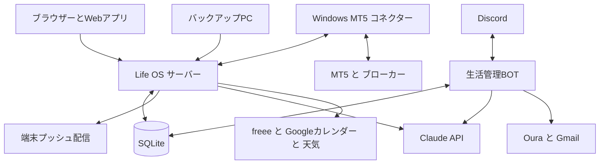

# Life OS 仕様書

作成日：2026年10月20日　文書版：1.0

Life OSは、予定・健康・トレーニング・お金・FX・通知を一つの画面で管理する個人向けアプリです。日々の手入力を減らし、集まった情報から「今日どう動くか」を判断しやすくします。

本書は2026年10月20日時点の実装を対象とした、機能仕様と利用ガイドです。前半は使い方、後半は自動化の条件と開発・運用の引き継ぎ情報を扱います。個人の残高、収入額、認証情報、口座番号は掲載しません。

利用先：[Life OS](https://dashboard.nami-tool.com/)

## 1 全体像

| 分類 | モジュール | 主な役割 |
| --- | --- | --- |
| ホーム | ダッシュボード | 時刻、天気・気圧、健康、予定、タスク、お金、FXをまとめて確認 |
| 毎日の管理 | スケジュール | タスク、リマインド、予定、Googleカレンダーを一つに表示 |
| 毎日の管理 | アイデア | 思いつきを保存し、Markdownに整理して持ち出す |
| 毎日の管理 | メモ | 方針や好み、決定事項を保存し、BOTの会話に反映 |
| からだの管理 | 健康 | Oura、食事、美容、検診をまとめ、相互に参照 |
| からだの管理 | トレーニング | セットの記録、履歴、種目カタログ、最高重量と推定1RM |
| お金・資産 | 資産 | 個人・法人の口座残高、円換算、推移、資金計画、FP相談 |
| お金・資産 | カード利用 | 今月の利用、予算残り、引落予定、利用明細と節約の提案 |
| お金・資産 | FXシグナル | 通貨ペア、チャート、MT5保有・履歴、3ルールの自動売買 |
| お金・資産 | お金 | 発行請求書、報酬、源泉徴収の集計、請求書メールの確認 |
| お金・資産 | 明細 | 著作権使用料や配信収益などの明細公開メールを集約 |
| その他 | バックアップ | 別PCから届くバックアップ結果と履歴を確認 |
| その他 | リクエスト | 機能要望の登録、検索、対応状況の管理 |
| その他 | 設定 | 通知、地域、気圧、表示、各サービスへの接続設定 |

基本的な利用者は登録済みの本人です。Discordの所有者とダッシュボードの利用者を対応付け、履歴・残高・通知などを管理します。複数人での共同編集や、家族・社員ごとの権限管理を中心にした製品ではありません。

## 2 最初に行う設定

1. Life OSにログインする。
2. 「設定 → 天気・体調」で、天気を表示する市区町村を選ぶ。
3. 通知を受ける端末で「設定 → 通知」を開き、「この端末で通知を受け取る」を押して許可する。
4. 「テスト通知を送る」を押し、OSの通知センターで受信を確かめる。
5. 「端末に送る通知」で、モジュールごとにON/OFFを選ぶ。
6. 必要に応じてGoogleカレンダー、Gmail、Oura、freee、WindowsのMT5を接続する。

端末登録とモジュールのON/OFFは別です。モジュールがONでも、その端末が未登録・通知拒否なら届きません。

### アプリとして使う

Life OSはブラウザーと、ホーム画面・Dockなどに追加したWebアプリで利用します。画面タイトルは「Life OS｜開いているモジュール」です。

- Mac：Safariで開き、Dockに追加して利用する。
- iPhone・iPad：対応するOSでSafariからホーム画面に追加し、そのLife OSを開いて通知を許可する。プッシュ通知はiOS・iPadOS 16.4以降が対象。
- Android：対応ブラウザーで開き、端末側の通知を許可する。
- デスクトップではサイドバーをアイコンだけに折りたためる。スマホでは左端から右へのスワイプ、またはメニューボタンで開く。
- 表示テーマはライト・ダーク・システム連動から選ぶ。

Web Pushの見え方、音、アイコン、集中モードによる抑制はOSとブラウザーの設定にも依存します。

## 3 ダッシュボード

起点は「今日、何を確認してどう動くか」です。

| 表示 | 内容 |
| --- | --- |
| 時刻と短い一言 | 日本時間の時計と、健康・活動・支出などに応じた短い案内 |
| 天気・気圧 | 現在付近の天気、気温、雨の見込み、気圧の変化 |
| 健康 | Ouraの値と記録時点、睡眠バランス、活動・休養の提案 |
| タスク | 未完了タスク。カードから追加可能 |
| 今週の予定 | 今日から1週間の予定を日付順に確認 |
| カード利用 | 個人カードの今月利用と予算の状況 |
| FX | 通貨ペアと運用状況への入口 |
| 通知ベル | 未読通知の確認と既読操作。各モジュールからアクセス可能 |

健康の行動提案は、Ouraの今日の目標（回復度で上下する活動目標）と厚労省「健康づくりのための身体活動・運動ガイド2023」（成人: 3メッツ以上の活動を1日60分以上 ≒ 8,000歩、運動 週60分以上、筋トレ週2〜3日、座りっぱなしに注意）、WHO 2020（中強度 週150〜300分、筋トレ週2日以上）を基準にします。歩数は8,000歩を下限に「あと何歩 ≒ 早歩き何分」で具体的に勧め、今週の中〜高強度の分数（高強度は2倍換算）と筋トレ日数の不足も示します。座位が6時間を超えたら50分ごとに2〜3分歩くよう促します。コンディション60未満または体温+0.5℃以上は積極的休養（6,000歩）、50未満または+1.0℃以上は休養優先（4,000歩）に切り替えます。欠測や古い値を「今日の値」として扱いません。

通知は開く、個別に既読にする、まとめて既読にすることで未読一覧から消えます。元の取引・予定・明細が消える操作ではなく、既読一覧からの再確認や未読への戻しにも対応します。

## 4 スケジュール

画面：[スケジュール](https://dashboard.nami-tool.com/planner)

### 管理する4種類

| 種類 | 用途 | 日時と編集 |
| --- | --- | --- |
| タスク | やることと完了状態 | 日付だけ指定可能。時刻・長さは付けず、カレンダーの終日欄へ配置 |
| リマインド | 指定時刻に知らせる | 通知時刻を設定。日付指定なしに戻すと通知待ちを解除 |
| この画面の予定 | Life OS内の予定 | 日時と長さを設定。編集・削除・日付指定なしへの変更が可能 |
| Googleカレンダー | 外部カレンダーの予定 | 参照用。ダブルクリックするとGoogleカレンダー側へ移動 |

### よく使う操作

- ページ上部の追加ボタンから登録する。
- 時間のグリッドをダブルクリックし、「タスク」か「予定」を選んで追加する。予定はクリックした時間、タスクはその日付の終日欄へ入る。
- 日付指定なしのカードをカレンダーへドラッグして配置する。
- 日付指定なしのグループへ戻すと、予定の配置を外せる。
- 予定の上下の縁を引っ張り、時間の長さを調整する。タスクと通知時点だけのリマインドには長さを付けない。
- 項目をクリックすると詳細を開き、編集・削除・完了などを操作できる。
- 完了済みタスクは別にまとめる。Google予定はタスクカード一覧に重複させない。

カレンダーは今日を左端にした表示が基本です。土曜日は青、日曜日は赤系で区別し、日付・曜日・終日欄を見失いにくく配置します。Shift＋スクロールで表示日を横に進められます。

Googleカレンダーの取得はローカル項目の取得と分けて行い、外部サービスの待ち時間でタスク表示を止めません。Life OS内で追加した予定をGoogleカレンダーへ自動登録する機能ではありません。

削除した一部の項目は内部にアーカイブを保持しますが、一般利用者向けのゴミ箱・復元画面はありません。

## 5 アイデアとメモ

### アイデア

画面：[アイデア](https://dashboard.nami-tool.com/ideas)

1. 思いついた内容を自然な文章で保存する。
2. 必要なときにAIで整理する。
3. タイトルやMarkdownを編集し、状態を整理する。
4. Markdownのコピー、またはダウンロードでObsidianなどへ取り込む。

元の文章を先に保存するため、AI整理に失敗しても原文は残ります。整理後の文と原文を両方保持します。状態は未整理・いつか・次にやる・完了を管理し、アーカイブにも対応します。

ObsidianのVaultへの直接書き込み・常時同期は行いません。エクスポートしたMarkdownを取り込む方式です。

### メモ

画面：[メモ](https://dashboard.nami-tool.com/notes)

方針、決定、約束、好み、その他のメモを記録します。有効なメモはBOTの会話で参照する前提になります。前提から外したいものはアーカイブします。アイデアの保管とは用途が異なります。

## 6 健康

画面：[健康](https://dashboard.nami-tool.com/health)

「体調」「食事」「美容」「検診」の4タブで構成します。Ouraの活動・回復、食事と美容のルーティン、検診、筋トレ記録を共通の相談材料として利用します。

### 体調とOura

Ouraから睡眠時間、睡眠スコア、コンディション、歩数、心拍変動、安静時心拍、睡眠バランスを取り込み、値と日付を表示します。日々の水分量や体脂肪率の手入力を前提にしません。

**睡眠バランスはOuraの0〜100のスコアです。** 睡眠負債が何時間あるかを示す値ではなく、時間数に変換しません。

Ouraの同期はサーバーで24時間、10分ごとに実行します。ただし、リングの情報がOura側へアップロードされていなければ新しい値は取得できません。データ同期と朝の通知は独立しています。

### 食事

毎食の記録ではなく、普段食べるルーティンを登録し、1日分の栄養を集計します。エネルギー、三大栄養素、食物繊維、食塩、ミネラル、ビタミンなどを、保存した目標と比較します。

- 朝・昼・夜などに食品を登録し、量、栄養、1回分の費用を管理する。
- 未計算の栄養はAIで推定でき、推定値と記録済みの値を区別する。
- 食事チャットで相談し、目標案や不足している栄養値の推定案を受け取る。
- 「この目標を使う」「推定値を反映」を押して保存する。
- 食費は登録済みの1回分の費用を基に概算する。未入力を無料と扱わない。

ルーティンは「食べる予定」であり、実際に食べた実績ではありません。栄養値が一部しか分からない場合は、合計を途中の値として表示し、不足・過剰を断定しません。

### 美容

普段のケアや使用するもの、タイミング、目的を登録します。美容チャットは睡眠・食事・活動・検診なども参照し、「続けること」「追加候補」「見直すこと」を提案します。提案は「この方針を使う」で反映します。商品をWebで探す場合は、検索を有効にして根拠となるリンクを確認します。

### 検診

年1回程度の更新を想定し、一つの「検診」タブに受診日と数値を保存します。

登録対象はLDL、HDL、中性脂肪、総コレステロール、HbA1c、空腹時血糖、血圧の上下、γ-GTP、AST、ALT、尿酸、クレアチニンとメモです。

健康チャットは生活の相談を補助します。検査値から病気の診断や治療方針を決定する機能ではありません。

## 7 天気と気圧

設定先：[設定の天気と体調](https://dashboard.nami-tool.com/settings#weather)

市区町村の位置情報に基づき、Open-Meteoの天気・降水・海面気圧を取得します。ダッシュボードでは天気と気温、雨の見込み、現在付近の気圧、3時間・6時間の変化、先の気圧推移を確認できます。

### 気圧変化の標準判定

| 指標 | 注意 | 強い変化 |
| --- | --- | --- |
| 3時間の変化の大きさ | 2.5 hPa以上 | 4.0 hPa以上 |
| 6時間の変化の大きさ | 4.0 hPa以上 | 6.0 hPa以上 |
| 判定期間内の気圧の幅 | 5.0 hPa以上 | 8.0 hPa以上 |

上昇・下降の両方を対象にします。単に気圧が低いだけでなく、変化の大きさやタイミングを扱います。欠測がある場合は安定と断定しません。

「今しんどい」から体調と気圧の時点を残し、後から症状の修正・削除ができます。有効な記録が5件以上あり、比較に必要な履歴が揃うと、本人の記録と気圧変化の関連を調べて個人用の基準を作ります。関連が明確でない場合や履歴不足では、個人基準が完成したことにはしません。これは体調と気圧の関連の目安であり、因果関係の証明ではありません。

## 8 トレーニング

画面：[トレーニング](https://dashboard.nami-tool.com/training)

記録、履歴、種目、重量・1RMを一つのモジュールにまとめます。

### 記録する

1. 部位を選んでセッションを開始する。
2. カタログから実施する種目を選ぶ。
3. 重量、回数、必要なメモをセット単位で記録する。
4. その日のトレーニングを終了する。

Discordからも自然文で開始・セット記録・次の重量の相談・終了ができます。記録に応じた休憩タイマーや、回数を伸ばしてから重量を上げる進め方を補助します。

カタログは一般的な筋トレ96種と既存のボルダリングを収録します。名前・別名・部位・器具で検索でき、確認済みの重複種目は標準種目へ統合します。器具や重量単位が異なるものを名前だけで同一扱いしません。

### 記録単位と最高重量

- ダンベルは片手重量、スミスのプレート方式はプレート重量のまま扱う。
- 自重種目は回数、プランクなどは保持時間で管理する。
- 最高重量は過去の全セットから選ぶ。1セット目だけを対象にしない。
- 同じ重量なら回数が多い記録、さらに同じなら新しい記録を選ぶ。
- 選んだ最高重量のセットに対し、Epley式「重量 ×（1＋回数÷30）」で推定1RMを表示する。1回の記録はその重量、計算対象は1〜30回。11回以上は参考値として区別する。
- 自重・保持時間・単位不明の記録に、重量の1RMを付けない。

筋トレ記録は健康モジュールとダッシュボードの行動提案でも共有します。

## 9 資産

画面：[資産](https://dashboard.nami-tool.com/assets)

個人と法人の口座、銀行預金、証券、FX、暗号資産、保険・共済などを分類し、残高と円換算評価額を管理します。「概要」「残高を入力」「口座の管理」「使う・運用する」「FP相談」などを使い分けます。カード利用は独立モジュールです。

### 残高と推移

- 円建て口座は円残高、外貨などは口座に設定した単位の数量を記録する。
- 数量、換算レート、レート日、取得元、円評価額を組として保持する。
- 空欄は不明、0は残高ゼロ。前回値のコピーは空欄だけに適用する。
- 名義・口座・資産区分や期間で推移を絞り込める。
- 残高の増減には入出金が含まれるため、そのまま投資の利益・損失とは見なさない。
- 総資産の表示は、負債をすべて自動控除した純資産とは区別する。
- 期間を広げても、存在しない過去データを作らない。指定期間と実際の記録範囲を区別する。
- CSVの書き出し・過去記録の取り込みに対応する。

### freee経由の銀行同期

個人・各法人のfreee事業所を接続し、口座の名義と資産画面への反映先を指定します。約1時間ごとに、freeeに保存された銀行同期残高を取得します。

Life OSの更新操作はfreeeを再確認する操作です。銀行からfreeeへの同期そのものを強制する操作ではありません。銀行側の認証切れはfreee側で更新する必要があります。

銀行同期の時点が2日を超える、エラー、未取得などの場合は参考額として扱います。より新しい手入力値は優先し、信頼できる残高がなければ利用可能額の判断を保留します。要確認の口座は接続状態の確認画面へ進めます。

正常に同期できる当日の円建て銀行口座は残高入力画面にも自動表示します。元の手入力履歴を上書きする方式ではありません。証券口座の保有銘柄・時価をfreee経由で自動収集する機能は対象外です。

### 使う額と運用する額

個人の円預金、生活費、予定支出、負債、確保する資金、収入などから、守る額・使う額・運用に回す額の案を計算します。法人資金や価格変動のある証券・FX・暗号資産を、個人がすぐ使える円預金に混ぜません。

FPチャットでは保存した資産・カード・計画の情報を参照して相談できます。提案を受けても銀行送金や投資商品の購入は実行しません。

## 10 カード利用

画面：[カード利用](https://dashboard.nami-tool.com/cards)

三井住友カードの利用通知メールをGmailから取り込み、月ごとの利用額・予算・支払予定を整理します。Vpassの口座へ直接ログインして明細を取得する方式ではありません。

### 画面の中心

| 項目 | 何を示すか |
| --- | --- |
| 今月の利用累計 | 今月1日から現在までの取得済みのカード利用 |
| 月予算の残り | 設定予算から今月の利用累計を引いた値 |
| 累計グラフ | 利用日ごとの利用累計。口座残高や法人を含む総資産ではない |
| 利用タイムライン | いつ、どこで、いくら使ったか。各回の金額と月内累計 |
| 今月の支払い | 締め済みの請求額と実際の引落予定日 |
| 追加利用の目安 | 個人の現金余力と未払いを踏まえた、今月さらに使う額の目安 |

締め済みの請求と、まだ増える今月の利用を分けます。累計グラフの対象は利用期間で、締め日を過ぎた支払日まで利用が増え続けるグラフにはしません。利用通知は承認時点の速報であり、確定請求とは異なります。

### 確定明細と支払日の確認

CSV明細を取り込み、請求月と引落日を本人が確認して登録します。合計と明細行の整合性を検証し、支払額を通知メールの概算より正確に把握できるようにします。休日などによる実際の引落日の変更は、確定情報を優先します。

メールには未取得・遅延・取消・対象外の支出があり得ます。CSVの登録だけで、銀行からの引き落とし完了を自動判定するものではありません。

### 追加利用の目安の考え方

1. 信頼できる個人の円預金から、確保する現金と確認済みの未払いカード額を差し引く。
2. 次回の賞与予定までの残り期間に対して、今月に使う現金の上限を按分する。
3. 「月予算の残り」と「現金から見た今月の上限」の小さい方を追加利用の目安にする。

未払いが未確認、入力した未払いが取得済み通知額より小さい、残高が古いなどの場合は、使える金額を無理に確定しません。将来の賞与や給与を、既に預金にあるものとして加えません。

店名・分類・利用ペースから使いすぎや削減候補を示し、FP相談で具体的な代替案を相談できます。

## 11 FXシグナル

画面：[FXシグナル](https://dashboard.nami-tool.com/fx)

通貨ペア、チャート、保有・履歴、履歴・成績、自動改善、設定・接続の画面があります。現行の実口座運用は、WindowsのMT5で動く以下の3ルールです。

### 運用する3ルール

| 項目 | ルールA改良版 | ドンチャン改良4 | ドンチャン改良6 |
| --- | --- | --- | --- |
| 判断する足 | 確定1時間足 | 確定4時間足 | 確定4時間足 |
| 上位足 | 日足・4時間足・1時間足 | 日足・4時間足 | 日足・4時間足 |
| 主なきっかけ | 押し目後の反発と直前3本の突破 | 直前24本の4時間足の高安突破 | 改良4の型に加え日次R1・S1の外 |
| 数量 | 共通lot | ルールAと共通lot | 1回の想定損失60 USDから計算 |
| 追加 | 同量を最大3回 | なし | なし |
| SL距離の倍率 | 原点までの距離の0.5倍 | 1倍 | 1倍 |
| TP | 費用を考慮した3R | 同左 | 同左 |
| トレーリング | 100 pipsで発動、M5 SMA20±10 pips | 60 pipsで発動、最高・最安から50 pips | 60 pipsで発動、最高・最安から30 pips |
| 保有期限 | 最大18時間、または次の05:00 JST | 最大48時間、または土曜05:00 JST | 同左 |

対象はUSD/JPY、EUR/JPY、GBP/JPY、AUD/JPY、EUR/USD、GBP/USD、AUD/USDの7通貨です。買い・売りの両方を扱います。画面に別の通貨の参考価格が表示されても、この3ルールの自動売買対象が増えるわけではありません。

各ルールは全対象通貨を通して1組まで保有でき、3ルールの同時保有を許可します。ルールAは初回と追加をまとめて1組と数えるため、最大3組は最大3本のポジションという意味ではありません。最大構成はAの4本と改良4・6の各1本です。

### 準備条件とエントリー条件

ルールAの準備は、各上位足で終値とSMA10がSMA90のトレンド側にあり、SMA10が3本前と比べた傾きも揃い、直前8本のH1にSMA16±0.35×ATR14への接触があり、H1終値も日足SMA10のトレンド側にあることです。

エントリーには、H1 ADX14が25以上、トレンド方向の実体が0.2×ATR14以上、直前3本の高安突破、H1 SMA10との距離が85 pips未満という条件が加わります。売りは向きを反転します。

改良4・6の準備は、日足とH4のSMA10・90と傾きが揃い、H1で押し目・戻りを作っていることです。日足の傾きは15本前、H4は3本前と比較します。履歴・鮮度・H1の連続性・年度設定の有効性も確認します。エントリーはH4の24本突破と取引時間帯、改良6ではさらに日次R1・S1の外側という条件を確認します。

### 通貨ペアの準備マーク

| 表示 | 意味 |
| --- | --- |
| 青い背景と「✓ 準備OK · BUY」 | 買いの準備条件が揃い、エントリー条件を待っている |
| 赤い背景と「✓ 準備OK · SELL」 | 売りの準備条件が揃い、エントリー条件を待っている |
| 「◆ 条件成立 · BUY／SELL」 | エントリー条件まで成立している。約定済みを意味しない |
| 準備待ち | 準備条件がまだ揃っていない |
| 更新待ち | 新しい有効な判定を確認できない |

マークはWindowsから届いた確定足の判定に基づきます。価格の動きだけで未確定足を成立扱いしません。受信が45秒を超えて止まったとき、ルールAの判定足が90分、改良4・6が5時間を超えて古くなったときなどは、準備の強調を解除します。自動エントリーを停止しているルールは、その旨も表示します。

### チャート

- 通貨ペア名から対象ペアのチャートを開く。
- 最初は直近6時間の5分足ローソク。1日・3日の表示にも切り替えられる。
- 価格チャートは16:9。上下に余白を取り、近くのSMAを含める。遠い水準は「全水準表示」で確認できる。
- ルールA・改良4・改良6を切り替え、そのルールのSMA、押し目帯、突破水準、SLの参考線、ATR、必要なADXなどを表示する。
- 指標ごとに表示・非表示を切り替える。
- 土日や欠損時間の空白は詰める。時刻の表示は実際の日時を保持する。
- 保存済みの範囲をドラッグ、前後ボタン、Shift＋ホイールなどで移動する。過去の取得範囲を広げる操作は保存済みデータの範囲内で行う。現在の画面の追加読み込みは最大30暦日が上限。
- 取得できた約定のエントリー・決済、シグナルの発生箇所を表示する。約定マーカーは口座全体の取得履歴として扱い、選択した戦略の約定だけと誤認しない。
- デイリーピボットはP、R1〜R3、S1〜S3を扱う。改良6はJST06:00区切りの日足を使う。A・改良4のチャートの参考ピボットはXMの取得日足を使い、トレンド判定用のUTC日足とは区別する。
- 日足SMA90などの長い指標用に、WindowsからH1履歴を別途共有する。履歴が足りない区間の線を推測で埋めない。

### 注文と保有の管理

買いのSL原点は、直近5本のH1安値−0.1×ATR14と、H1判定終値−0.5×ATR14の低い方です。売りは高値側へ反転します。表の倍率を適用したSL距離を基にTPを決めます。実装上のTP距離は3×SL距離＋4×1.2 pipsで、実勢Ask・Bidに含まれるスプレッドを重ねて加算しません。

実口座への初回注文、Aの追加、SL・TP、トレーリング、時間決済はWindows側で行います。サーバーは許可・設定・状態・履歴・通知を保持します。確定後30秒以内に最初に取得できた実勢Ask・Bidで実行し、遅れた条件を後追いで発注しません。過去検証の5分足始値と実約定価格は一致を保証しません。

共通lotの変更はA・改良4の次の新規取引から反映します。保有中のAの追加は、開始時のlotを維持します。改良6は共通lotに連動せず、SLまでの予定損失と費用を60 USD以内にする数量へ切り下げます。窓開けや滑りによる実損失まで60 USD以内に保証するものではありません。

3ルールの確定した実現Rを合算し、日−2R・週−3R・月−2Rで新規・追加を停止します。期間の区切りはUTCです。売買ルールごとの保有期限に用いる05:00はJSTです。

手動や他システムの未照合ポジションを自動で引き継ぎません。確認できない注文結果は無条件に再送せず、新規・追加を止めて照合します。ルールごとの台帳で、自分の管理対象だけを保護・決済します。

実際のエントリー・追加・決済は履歴と一緒に通知待ちへ保存し、FX通知がONのDiscord・登録端末へ配信します。通知の再試行で注文を再送しません。現行の自動売買の約定通知に、さらに同じ注文を出すための手動発注ボタンは付けません。

### 停止と更新

Windows、MT5、コネクターが稼働している必要があります。PC停止・スリープ中は新しい判断、追加、トレーリング更新、時間決済が実行できません。既にブローカーへ設定されたSL・TPは別に保持されます。

サーバーの許可は約5秒ごとに同期し、単一端末の実行リースは30秒です。通信不能で許可が失効した場合は新規・追加を止めます。設定から新規を停止しても、端末が動いていれば既存の管理ポジションの保護と決済は継続します。

更新は「設定・接続 → かんたん更新・インストール」から取得し、Windowsで実行します。診断用ファイルのダウンロードにも対応します。管理台帳を削除して停止理由を消す運用は行いません。

### 成績と自動改善の範囲

現行3ルールの実取引は、過去の研究結果や旧ルールの仮想成績と分けて集計します。過去のPFや勝率を、実運用の成績として表示しません。

改良4・6の2026年度の設定は固定です。毎年の検証・再選定という研究方針はありますが、実運用中に無検証で設定を選び直して自動採用する機能ではありません。次回期限の2027年10月1日以降は、新しい設定を導入するまで新規を停止し、既存保有の管理を続けます。

## 12 明細とお金

### 収益の明細

画面：[明細](https://dashboard.nami-tool.com/royalty)

対象はNexTone、D-Coret、MCJP、rights.services、ポニーキャニオン、BASEMINTの6種類です。NexToneの「配信使用料分配明細公開のお知らせ」も含めます。

Gmailの送信元、件名、本文、対象年月、公式ポータルのリンクなどを組み合わせて、著作権使用料・配信収益の明細通知を分類します。スターバックスやGoogle Playなどの日常の購入明細を、この収益明細の一覧へ無差別に集めるものではありません。

対象、要確認、対象外を区別し、配信元・対象月・処理状況などで確認します。明細サイトを自動で開いてログインし、全明細をダウンロード・金額集計する機能とは別です。公開通知の到着と、実際の入金確認も区別します。

### 請求書と源泉徴収

画面：[お金](https://dashboard.nami-tool.com/finance)

自分が発行した請求書について、請求先、請求日、報酬、消費税、源泉徴収額などを記録し、月別に集計します。保存したPDF記載の値と計算値の照合、請求書・領収書メールの検知条件、前月分の源泉徴収の確認通知を扱います。申告・納税の実行機能ではありません。

## 13 通知

設定先：[通知の設定](https://dashboard.nami-tool.com/settings#notifications)

端末プッシュのON/OFFをモジュールごとに1つのスイッチで設定します。種類が複数あるモジュール（お金、ダッシュボード）は開くと種類ごとにも選べます。受け取る端末の登録も必要です。端末はブラウザ・インストールしたアプリごとに「Mac Chrome」「Android Chrome（アプリ）」のような名前で一覧に出て、個別に解除できます。

モジュールはスケジュール（リマインド）、健康（就寝）、トレーニング、FXシグナル、お金（請求書・領収書、源泉徴収）、明細、バックアップ、画像生成、ダッシュボード（朝のお知らせ、週次まとめ）、システムです。

### 3つの通知の場所

| 場所 | 用途 | 既読やON/OFF |
| --- | --- | --- |
| アプリの通知ベル | アプリ内で履歴と詳細を確認 | 既読にすると未読一覧から除外。元データは保持 |
| 端末プッシュ | Mac・Android・iPhoneのOS通知 | モジュール別設定と端末登録の両方で管理 |

ベルにはプッシュをOFFにしたモジュールの通知も記録されます。Discordへの送信は停止しました。

朝に含める内容はOura・予定・タスク・食事から選びます。朝の通知は日単位で重複を防止し、Ouraの10分ごとの同期とは分けて制御します。通知をOFFにしても、Oura同期やFXの監視自体は停止しません。

通常の通知には種類に応じた有効期限と再試行があります。OFFからONへ戻しただけで過去の通常通知を一斉再送しません。実際のFX約定通知は取りこぼしを避けるため、一般の短期限の候補通知と異なる再試行方針を使います。通知OFF・端末解除・購読失効は尊重します。

「送信済み」は通知サービスが受け付けたことを示し、OSが表示したことや本人が読んだことまでを保証しません。Web Pushが届かないときは、端末の通知許可、集中モード、端末登録、カテゴリのON/OFFを順に確認します。

## 14 バックアップ

画面：[バックアップ](https://dashboard.nami-tool.com/backups)

別PCで実行するDropboxのバックアップ処理が、終了時の要約をLife OSへ送信します。Life OSはバックアップ本体の実行やファイル同期・pruneを代行せず、結果の受信・表示・通知を担当します。

開始、完了、所要時間、個人・チームの件数と容量、エラー、判定などを確認できます。履歴は所有者ごとに最大500件、一覧は30件単位です。最後の受信から36時間を超えた場合は未受信として扱い、それだけでバックアップ失敗とは断定しません。

受信APIは `POST /api/integrations/backups` です。専用の送信用トークンをヘッダーに指定し、要約を `content` として送ります。実行IDを指定した再送は重複を防止します。新規受信は201、同じ実行の再送は200です。

バックアップPC側では独自に書いた送信部から同APIへ送る構成にも対応します。接続設定はそのPCに保管し、本文やログにトークンを混ぜません。接続用の鍵を再発行した場合は、PC側も新しい設定へ更新します。

## 15 Discord BOT

2026-10-24から停止中です（下記は停止前の仕様）。

Discordは、通知を受ける入口と自然文で記録・相談する入口を兼ねます。

- DM、メンション、設定済みの会話チャンネルから利用する。
- サーバーごとに一つの通常テキストチャンネルを会話用に設定でき、その中ではメンション不要。
- `!chat here` で現在のチャンネルを指定、`!chat status` で確認、`!chat off` で解除する。変更は登録済み所有者が行う。
- `!dash`、`!dashboard`、または「資産のURL」などの短い依頼で該当画面へのリンクを取得できる。
- 筋トレなどの記録は自然文を解釈して、保存・計算用の機能を呼び出す。

会話チャンネルの解除と会話履歴のリセットは別です。BOTやWebhookの発言へ自動反応して会話を連鎖させません。音声入力を文字として送る使い方と、このアプリ自体に常時音声通話機能を備えることも区別します。

## 16 リクエスト

画面：[リクエスト](https://dashboard.nami-tool.com/requests)

タイトル、詳細、具体例を登録し、未対応・対応中・完了の状態を管理します。カード形式で一覧し、検索や状態別の表示に対応します。要望の登録だけで、アプリのコード変更や本番反映を自動実行するものではありません。

## 17 自動化と手動操作の境界

| 処理 | 自動で行う部分 | 本人の操作が必要になる場面 |
| --- | --- | --- |
| Oura | サーバーで10分ごとに同期 | 初期認証、Oura側へのリング同期、認証の更新 |
| Googleカレンダー | 接続済み予定の取得と表示 | 接続設定、Google側での予定編集 |
| Gmail | 設定した条件で通知・明細メールを収集 | 初期認証、対象条件や分類の確認 |
| freee | 約1時間ごとに銀行同期残高を取得 | 初回接続、反映先確認、銀行の再認証 |
| カード | 利用通知の集計、予算・ペースの計算 | 確定CSV、引落日、未払い・現金の確認、予算設定 |
| 健康 | 登録ルーティンの集計、共有情報の組み立て | 初回のルーティン、検診、AI提案の適用 |
| FX | 許可済み3ルールの判断・注文・保護・履歴 | WindowsとMT5の稼働、更新、障害確認、年度設定の更新 |
| バックアップ | 要約の受信・履歴化・通知 | 別PCのバックアップ実行環境と送信設定の維持 |
| 通知 | 永続キューからの配信と再試行 | 種類別ON/OFF、端末登録、OSの許可 |

AIは会話、相談、アイデア整理、食品の栄養推定などを担当します。残高やカード利用の集計、FXの指標・注文条件、通知の重複防止などは主に決められたプログラムで処理します。

## 18 更新の目安と障害時の確認

### 主な更新間隔

| 対象 | 間隔と意味 |
| --- | --- |
| ダッシュボードの時計 | ブラウザーで毎秒 |
| アプリ内通知の確認 | 表示中は約45秒ごと |
| Oura | サーバーで10分ごと |
| freee残高 | 約1時間ごと。銀行同期日時は別 |
| FXの端末状態・許可 | 約5秒ごとの同期、実行リース30秒 |
| FXの通貨ペア表示 | 表示中は約5秒ごとに更新 |
| FXチャート | 表示中は約30秒ごとに更新 |
| 通知の配信処理 | 主な送信待ちを約5秒ごとに確認 |

更新周期は外部データの発生頻度や配信完了までの保証時間ではありません。市場休場、サービス障害、端末停止、通信状況などで遅れます。

### 困ったとき

| 症状 | まず確認すること |
| --- | --- |
| 予定が見えない | 表示開始日、Google接続、対象カレンダー、取得結果 |
| Ouraが更新されない | Ouraアプリの同期、認証、各値の記録日 |
| 銀行残高が古い | freee側の銀行同期日時・認証、Life OSの反映先 |
| 今月使える額が出ない | 個人残高の鮮度、未払い額、支払完了の確認、予算・収入予定 |
| FXが更新待ち | Windowsの起動・スリープ、MT5へのログイン、コネクター、通信 |
| FXの準備OKから注文されない | エントリー条件、許可、取引時間、損失制限、未照合ポジション、注文履歴 |
| 長いSMAが出ない | Windows更新、H1履歴の受信状況、必要な日足本数 |
| プッシュが出ない | OS許可、集中モード、端末登録、種類別ON/OFF、テスト通知 |
| バックアップ結果が来ない | 別PCの実行ログ、送信設定、トークン、受信日時 |

## 19 システム構成

### 主な技術と配置

| 項目 | 実装 |
| --- | --- |
| Web | Python・FastAPI、HTML・CSS・JavaScript |
| BOT | Python・Discord BOT・会話モジュール |
| データ保存 | SQLite、主DBは `data/workouts.db` |
| 常駐 | `life-dashboard` と `kintore-bot` をPM2で管理 |
| FX実行 | WindowsのPythonコネクターとMT5 |
| 認証 | ダッシュボードのログイン・セッション、連携ごとの認証 |
| Webアプリ | マニフェストとService Worker。通知に利用 |

ブラウザーやMacを閉じても、サーバー上のOura同期・BOT・通知処理は常駐します。FXのWindows実行部と、別PCのバックアップ本体はそれぞれのPCの稼働が必要です。

### データと認証の扱い

- 記録・残高・通知は利用者を区別して保存する。一部の既存連携設定は所有者中心の構成で運用する。
- 更新系のWeb操作は認証に加えて同一サイトからの要求を確認する。
- 認証済みの画面・APIのデータをService Workerへ一律に保存する構成にはしない。
- freeeの接続トークンは暗号化して保存し、残高取得は読み取り権限を使う。
- MT5の接続は対象口座を照合し、実行台帳、注文意図、サーバー許可を用いて復元・重複送信防止を行う。
- AI相談には相談内容と必要な保存情報の要約を送る。すべてが端末内だけで完結する構成ではない。
- 認証情報は保護された設定に保持する。文書、画面、通知、通常ログへ掲載しない。

## 20 開発と運用の引き継ぎ

### ソースと主な担当ファイル

元プロジェクト：`/Users/nami/Claude/Projects/life-bot`

本番配置：`/home/rocky/kintore-bot`

| 領域 | 主なファイル・ディレクトリ |
| --- | --- |
| 全体画面・認証 | `dashboard.py`、`dashboard_theme.py`、`dashboard_drawer.py` |
| ダッシュボード | `dashboard_home*`、`dashboard_agenda.py`、`dashboard_briefing.py` |
| スケジュール | `planner/` |
| アイデア・メモ | `ideas/`、`notes/` |
| 健康 | `health_routes.py`、`health_data.py`、`health_coach.py`、`health_ui.py` |
| Oura・気圧 | `oura/`、`dashboard_oura.py`、`dashboard_weather.py`、`pressure_*` |
| トレーニング | `workout/`、`training_ui.py`、`training_strength_ui.py` |
| 資産・カード・FP | `assets/` |
| FX画面・保存 | `fx_signals/`。準備マークは `setup_ui.py`、チャートは `chart_ui.py` など |
| FX実行 | `windows_mt5/`。3ルールのエンジン、実行、更新、復元を管理 |
| 明細・請求 | `royalty/`、`finance/` |
| 通知 | `dashboard_notifications.py`、`web_push*`、`notification_preferences.py` |
| バックアップ受信 | `backup_notifications.py`、`backup_notification_routes.py` |
| 設定・リクエスト | `dashboard_settings*`、`backlog/` |

### 運用上の原則

1. 本番のDBと認証設定を、ローカルの検証用データで上書きしない。
2. 変更前に対象ファイルと必要なDBのバックアップを残す。
3. 模擬MT5、一時DB、合成価格などで動作を検証する。表示修正の確認のために実注文を出さない。
4. FXでは指標の式、時刻区切り、数量、同時保有、停止条件への影響を確認する。
5. 本番反映後にログイン後の画面、取得API、稼働状態を確認する。
6. 通知の受付成功・実際の画面表示・本人の既読を区別する。

### 関連する詳細仕様

元プロジェクト内の次の資料に、各機能の詳細があります。

- `docs/freee-connection.md`
- `docs/training-catalog.md`
- `docs/dashboard-notifications.md`
- `docs/mobile-push.md`
- `docs/backup-notifications.md`
- `docs/dashboard-links.md`
- `docs/fx-rule-a.md`
- `docs/fx-donchian.md`
- `docs/fx-donchian-v6.md`
- `docs/requests-20261020.md`

本書で整理したタスクの終日配置、freee残高反映、通知、現行3ルールなどは、初期のREADMEだけでは追えない追加仕様です。今後の改修では、本書と該当箇所の実装を合わせて更新します。
